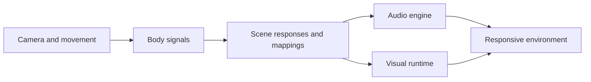

# FanRows

FanRows is a browser-based platform for embodied sound interaction. It lets
movement shape layered sound, visual feedback and the progression through an
interactive session in real time.

- Website: [fanrows.com](https://fanrows.com)
- System overview: [FanRows architecture](https://fanrows.com/explore/architecture)

> The FanRows source code is not publicly available. This repository documents
> the interaction model and the public-facing configuration concepts.

## What FanRows does

FanRows treats movement as material for shaping an environment, rather than as
a set of isolated commands. A participant can hold a posture, change the
opening of an arm, move with more or less energy, or repeat a movement. Those
measurements can gradually change sound layers and effects, trigger an
occasional sound, change a scene, or alter visual feedback.

The system is intended for creative practice, performance, sound exploration
and research into embodied interaction. It does not identify people or infer
emotion, personality, health status or other sensitive attributes.

## System at a glance



### Camera and movement

FanRows uses browser-based camera tracking with MediaPipe. It derives
measurements such as joint relationships, arm elevation, body direction,
movement velocity and stillness. Sessions can use these measurements directly,
or define named body signals with a source, range and smoothing value.

The camera image and real-time movement processing stay in the browser during
an experience. A session author chooses which measurements matter; a session
does not need to use every available signal.

### Sessions, scenes and materials

A **session** is an ordered set of scenes plus shared material, timing and
visual settings. A **scene** is the current interaction context: it can choose
its sound materials, background, text, body-sound responses and visual
configuration.

Materials can be sustained loops or single triggered sounds. Their source may
be an approved public file or a local workspace asset. FanRows does not treat
a valid configuration as proof that a file exists, plays in every browser, or
may legally be redistributed.

A scene can start materials automatically, manually, from a pose, or through a
response. Tempo synchronization is optional and applies to continuous loops;
one-shots follow their own trigger, cooldown and repeat behavior.

### Responses and mappings

FanRows has complementary ways to connect movement to sound:

| Mechanism | Use |
| --- | --- |
| Scene response | Connects an authored/public signal to a material change or a whole-room effect. |
| Pose mapping | Maps a binary pose state to an audio parameter. |
| Angle mapping | Maps a measured angle or body metric to an audio parameter. |
| Velocity mapping | Maps continuous motion to an audio parameter. |
| Cue and Room Life | Add optional scene-level, time- or movement-driven modulation. |

Responses can control level, filtering, stereo position, reverb sends, and
selected whole-room effects. Values can be smoothed so a change follows
movement over time rather than behaving as an abrupt switch. A one-shot
response can use beat-grid repetition and signal-controlled pitch selection.

Not every stored field is a player control: some values exist for Studio
authoring, descriptions or compatibility with older projects. The editor marks
incompatible response/target combinations rather than pretending they are
active.

### Audio and visuals

The audio engine is based on Web Audio and Tone.js. It can combine continuous
layers with one-shots and apply per-material or whole-room effects. The exact
behavior depends on the material type, start mode, response and active scene;
FanRows does not require every loop to run continuously.

Visual feedback can include the live body drawing, scene backgrounds, text
pages, Flying Stars, atmospheric overlays, response fields and Aura Glow
effects. Visual settings belong to a session or scene and are designed to
support the interaction without being required for audio playback.

### Studio and local workspaces

FanRows Studio provides authoring tools for sessions, scenes, intentions,
materials, signals, responses, visual settings and artist credits. Workspaces
are stored locally in the browser and can be exported or imported as a
`.fanrows` file. Imported workspaces are checked before being committed so
that incomplete or incompatible data can be reported without silently
overwriting local work.

A workspace export is portable project data, not a license for any included or
referenced audio. Authors remain responsible for the origin and redistribution
rights of their materials.

## Session configuration

A session document has a stable `id`, an ordered `scenes` array and can
declare `schemaVersion: 1`. The structural contract intentionally preserves
unknown properties so that older and future projects remain readable. A
separate semantic check verifies relationships such as unique scene IDs and
references from responses to signals and scene materials.

The following compact example shows one scene, one approved-audio placeholder,
one body signal and one response. It is illustrative, not an exhaustive
authoring template.

```json
{
  "schemaVersion": 1,
  "id": "example-session",
  "stackName": "Example Session",
  "stackBpm": 80,
  "masterVolume": 0.75,
  "bodySignals": [
    {
      "id": "left-arm-lift",
      "label": "Left Arm Lift",
      "sources": ["leftArmElevation"],
      "range": [34, 86],
      "smoothing": 0.85
    }
  ],
  "scenes": [
    {
      "id": "opening",
      "name": "Opening",
      "loops": {
        "bed": {
          "name": "Ambient Bed",
          "file": "/approvedAudio/your-own-loop.ogg",
          "type": "loop",
          "startMode": "auto",
          "volume": 0.6
        }
      },
      "visualConfig": {
        "sceneText": {
          "pages": ["Move slowly.\\nNotice the sound."],
          "position": "bottom",
          "fontSize": 31,
          "color": "#ffffff"
        }
      },
      "sceneIntent": {
        "responses": [
          {
            "id": "opening-filter",
            "signalId": "left-arm-lift",
            "materialId": "bed",
            "changeType": "filter_open",
            "depth": 0.5,
            "config": {
              "min": 300,
              "max": 2600,
              "tauUpSec": 0.6,
              "tauDownSec": 1.2
            }
          }
        ]
      }
    }
  ]
}
```

The audio path in this example is deliberately a placeholder. Replace it only
with audio that is present in the deployment and may be distributed there.

## Scope and current boundaries

FanRows is an evolving research and creative platform. Current public
documentation describes verified browser behavior, not a promise that every
historical configuration field or experimental setting has an active runtime
effect. In particular:

- Studio projects are local unless an author deliberately exports or shares
  them.
- Compatibility fields may be retained when old projects are read.
- Audio availability, browser decoding and licensing are distinct concerns.
- Optional local movement partners are rule-based/session features; they do
  not require a remote AI service.

## License

FanRows is currently documented as a research prototype. This repository
describes the system architecture and interaction model; it does not publish
the application source code or grant rights to audio material used by a
session.
