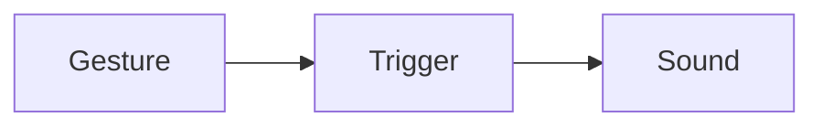
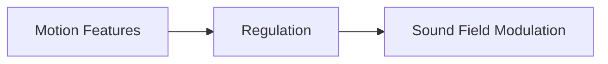
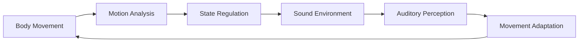
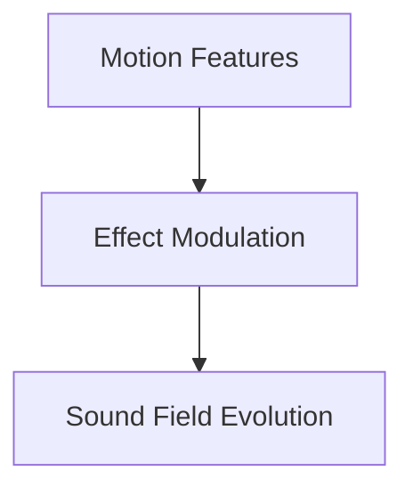
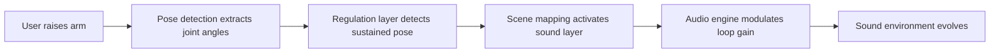

# FanRows

## Project Website
Learn more at:  
**Website: https://fanrows.com**  
**Architecture: https://fanrows.com/architecture**

---

⚠️ The FanRows source code is currently not publicly available. This repository documents the system architecture and interaction model.

## Overview

FanRows is a web-based studio for embodied resonance rooms: interactive sound and movement spaces where body motion shapes sound, visuals, and spatial experience in real time.

The system combines webcam-based motion tracking, MediaPipe, Web Audio, Tone.js, visual feedback, and configurable scene logic to create responsive sound environments in the browser.

Rather than using gestures as simple commands, FanRows treats posture, movement dynamics, stillness, and spatial presence as continuous signals. These signals regulate layered audio, effects, scenes, and visual responses without interrupting the flow of interaction.

Participants navigate an evolving sonic space through sustained movement and embodied feedback. FanRows explores how continuous body–sound coupling can open new forms of musical interaction, creative technology, and responsive audiovisual experience.

## Continuous Embodied Audio Interaction in the Browser

FanRows is designed as a system for continuous interaction between body movement and sound environments.

The system combines motion analysis, state-based interaction logic and a layered audio engine to transform body movement into continuous changes within a sonic environment.

Core components include:

- webcam-based pose tracking  
- continuous motion feature extraction  
- state-based regulation logic  
- layered audio environments  
- scene-based interaction spaces
- embodied resonance rooms
- interactive sound and movement spaces
- motion tracking audio
- Web Audio / Tone.js
- MediaPipe-based pose tracking

Together these components form a closed feedback loop between body movement and sound space.

FanRows runs entirely in the browser and is designed as a research-oriented interaction framework.

---

# Table of Contents

- Introduction
- Core Idea
- Interaction Model
- System Overview
- Motion Analysis
- Regulation Layer
- Audio Engine
- Scene System
- Mapping System
- Effect System
- Visual System
- Configuration System
- Studio Environment
- External Integration
- Technical Architecture
- Example Interaction Flow
- JSON Configuration Schema
- Example Session
- Future Development
- License

---

# Introduction

## What FanRows Is

FanRows is a browser-based system for continuous embodied audio interaction. Rather than treating gestures as discrete commands, FanRows interprets body motion as continuous signals that gradually reshape a sonic environment. The result is an evolving sound space that reacts to posture, movement intensity, stability, and sustained spatial configurations.

FanRows combines:

- pose tracking
- motion feature extraction
- state-based interaction logic
- a layered audio engine

---

# Core Idea

Most interactive music systems follow an event-based model:


FanRows instead uses continuous regulation:


Movement does not execute commands. Movement modifies the conditions of the sound environment.

---

# Interaction Feedback Loop

FanRows operates as a closed feedback loop:



The user becomes part of a dynamic system where motion and sound continuously influence each other.

---

# System Overview

FanRows consists of four main layers:

- Motion Analysis
- Regulation Layer
- Audio Engine
- Configuration System

Each layer operates continuously during interaction.

---

# Motion Analysis

FanRows uses webcam-based pose tracking.

Current implementation uses:

- MediaPipe Pose
- MediaPipe Hands (optional)

The system extracts spatial and temporal motion features such as:

- joint angles
- limb orientation
- movement velocity
- posture stability
- motion persistence

Example feature vector:

```json
{
  "velocity": 0.42,
  "acceleration": 0.18,
  "movementIntensity": 0.36,

  "stability": 0.73,
  "posturePersistence": 0.64,

  "rightArmAngle": 0.58,
  "leftArmAngle": 0.12,
  "rightElbowAngle": 0.47,
  "leftElbowAngle": 0.39,

  "shoulderWidth": 0.51,
  "bodyOrientation": 0.22,

  "handDistance": 0.34,
  "handHeight": 0.66,

  "centerX": 0.53,
  "centerY": 0.41,

  "poseConfidence": 0.92
}
```

**Motion dynamics**
| Feature				     | Meaning                              |
|--------------------|--------------------------------------|
| velocity			 	   | instantaneous body movement velocity |
| acceleration		   | change of movement velocity          |
| movementIntensity  | normalized motion energy             |

**Posture stability**
| Feature				     | Meaning                              |
|--------------------|--------------------------------------|
| stability				   | posture stability over time          |
| posturePersistence | duration a posture is maintained     |

**Joint angles**
| Feature				     | Meaning                              |
|--------------------|--------------------------------------|
| rightArmAngle		   | normalized shoulder angle            |
| leftArmAngle		   | normalized shoulder angle            |
| rightElbowAngle	   | elbow articulation                   |
| leftElbowAngle	   | elbow articulation                   |

**Spatial features**
| Feature			       |	Meaning                             |
|--------------------|--------------------------------------|
| centerX			       | body center horizontal position      |
| centerY			       | body center vertical position        |
| handDistance       |	distance between hands              |
| handHeight	       |	vertical hand position              |

**Tracking confidence**
| Feature				     | Meaning                              |
|--------------------|--------------------------------------|
| poseConfidence     | MediaPipe tracking confidence        |


Together these features define a multidimensional motion state space used by the regulation layer.

## Regulation Layer

The regulation layer converts motion features into stable interaction states.
Instead of reacting instantly to motion, the system evaluates:

- thresholds
- persistence over time
- spatial stability
- temporal windows

Example logic:

if pose detected for > holdTime

→ pose becomes active

This prevents unstable triggers and enables smooth interaction dynamics.

## Audio Engine

The audio engine uses a layered sound architecture. Multiple loops run simultaneously and remain synchronized.

Key characteristics:

- loops always running in sync
- gain-based activation
- BPM-synchronized playback
- continuous parameter modulation

Traditional audio engines:

- start loop
- stop loop

FanRows approach:

- loop always playing
- volume modulated

Advantages:

- seamless transitions
- no timing drift
- no playback artifacts

## Scene System

Interaction environments are structured into sessions and scenes.

Session: A session represents a complete interaction environment containing:

- scenes
- configuration parameters
- loop definitions

**Scene**

A scene defines:

- active loops
- motion mappings
- effect mappings
- visual settings

Scenes represent bounded interaction contexts.

## Scene Transitions

Scene transitions occur when sustained body states are detected.

Example:

arms crossed → switch scene

Transitions typically depend on pose persistence, stability thresholds, and temporal windows.

## Mapping System

FanRows connects motion features with audio parameters through a flexible mapping system.
Mappings translate continuous motion signals into changes in the sound environment.

### Mapping Types

FanRows supports several categories of motion-to-audio mappings:

| Mapping Type | Description |
|--------------|-------------|
| Pose Mapping | discrete pose detection triggers |
| Angle Mapping | continuous joint angle control |
| Velocity Mapping | movement speed modulation |
| Stability Mapping | posture stability modulation |
| Cue Mapping | temporal modulation patterns |

### Continuous Mapping

Mappings operate continuously rather than through discrete triggers.
Example mapping:

velocity → filter cutoff  
stability → reverb size  
arm angle → stereo pan

## Effect System

The FanRows effect system allows continuous modulation of audio parameters in response to body motion features.
Rather than applying static effects to audio signals, FanRows treats effect parameters as continuously regulated variables within the interaction loop.
Effects therefore become part of the dynamic sound field rather than fixed signal processors.
The system supports several layers of effect control.

---

### Effect Layers

Effects can be applied at multiple levels of the audio architecture.

| Level | Description |
|------|-------------|
| Global FX | Effects applied to the entire sound environment |
| Per-Loop FX | Effects applied to individual loop layers |
| Parameter Modulation | Continuous modulation of effect parameters |
| Cue Engine | Temporal variation and evolving modulation patterns |

This layered approach allows the sound environment to evolve smoothly without interrupting playback.

---

### Global Effects

Global effects influence the entire sound environment.

Typical global effects include:

- global reverb
- global filtering
- spatial widening
- master modulation effects

These effects help define the overall acoustic character of the sound field.

Example parameters:

- reverb.wet
- filter.frequency
- chorus.depth
- pitchShift.pitch

Global effects are typically modulated slowly in order to preserve perceptual stability.

---

### Per-Loop Effects

Each audio layer can have its own effect chain.
This allows individual sound layers to react differently to motion features.

Examples:

- pad layers may respond to arm angles
- air textures may respond to velocity
- drone layers may respond to posture stability

Example per-loop modulation:

velocity → filter cutoff
arm angle → stereo pan
stability → reverb amount

Because loops remain continuously playing, these modulations occur without retriggering the audio source.

---

### Continuous Parameter Modulation

Effect parameters are controlled by normalized motion features.
Each mapping converts a motion feature into a parameter range.

Example mapping:

velocity → filter.frequency (200Hz – 3000Hz)

This means that faster body movement gradually increases the brightness of the sound environment.
Parameter mappings typically include:

| Property | Description |
|--------|-------------|
|min | lower bound of parameter |
|max | upper bound of parameter |
|smoothing | optional parameter smoothing |
|target | effect parameter being controlled |

Example configuration:

```json
{
  "joint": "leftShoulderAngle",
  "loop": "birth_base",
  "target": "reverb.wet",
  "min": 0,
  "max": 1
}
```

This maps a shoulder angle to the wet level of the reverb applied to a specific loop.

### Effect Targets

The effect system can address many parameters inside the audio engine.
Typical targets include:

- filter.frequency
- reverb.wet
- chorus.depth
- delay.feedback
- pitchShift.pitch
- pan.pan
- gain.volume

These targets correspond to parameters within the Tone.js signal graph.

### Cue Engine

The Cue Engine introduces temporal variation into the effect system.
Instead of mapping motion directly to a parameter, the Cue Engine can generate evolving parameter states.
Typical uses include:

- slow atmospheric drift
- probabilistic parameter changes
- scene-dependent modulation patterns

This enables the sound environment to evolve even during periods of minimal movement.

## Regulation of Effect Changes

Because FanRows is based on continuous interaction, effect changes are typically smoothed over time.
Mechanisms include:

- parameter interpolation
- temporal smoothing
- persistence thresholds

This prevents abrupt sonic transitions and maintains perceptual coherence.

## Role in the Interaction Loop

Within the FanRows architecture, the effect system acts as the primary interface between motion features and the sound environment.



Rather than triggering sounds, the user continuously reshapes the acoustic properties of the environment.

This design allows the sound field to behave as a dynamic system that gradually reorganizes in response to embodied interaction.

---

## Visual System

FanRows includes a visual feedback layer. Possible visual elements:

- skeleton visualization
- background videos
- abstract overlays

Visual feedback helps users understand the relationship between movement and sound response.

## Configuration System

All interaction environments are defined through JSON configuration files.

Configuration defines:

- sessions
- scenes
- loops
- motion mappings
- effect mappings
- visuals

This enables reproducible interaction environments.

## Studio Environment

The Studio interface provides tools to:

- configure scenes
- adjust mappings
- calibrate thresholds
- inspect pose detection

Studio functions as a development environment for interaction sessions.

## External Integration

Future versions will expose motion features to external systems.

Planned interfaces:

- OSC
- WebSocket
- MIDI

Possible integrations:

- Ableton Live
- TouchDesigner
- Unity
- Max/MSP

## Technical Architecture

FanRows is implemented entirely in the browser.

| Component        | Technology              |
|------------------|-------------------------|
| Audio            | Web Audio API / Tone.js |
| Motion Tracking  | MediaPipe               |
| Runtime          | JavaScript              |
| Configuration    | JSON                    |

## Example Interaction Flow



## JSON Configuration Schema

Sessions are stored as JSON. The following small version-1 example illustrates a
scene material, an authored body signal, a response, and scene text. It is not
an exhaustive specification. Replace the audio placeholder with a file that
you own or are explicitly allowed to redistribute, and verify that the file
is actually present in your deployment.

```json
{
  "schemaVersion": 1,
  "id": "example-session",
  "stackName": "Example Session",
  "stackBpm": 80,
  "masterVolume": 0.75,
  "bodySignals": [
    {
      "id": "left-arm-lift",
      "label": "Left Arm Lift",
      "sources": ["leftArmElevation"],
      "range": [34, 86],
      "smoothing": 0.85
    }
  ],
  "scenes": [
    {
      "id": "opening",
      "name": "Opening",
      "loops": {
        "bed": {
          "name": "Ambient Bed",
          "file": "/approvedAudio/your-own-loop.ogg",
          "type": "loop",
          "startMode": "auto",
          "volume": 0.6
        }
      },
      "visualConfig": {
        "sceneText": {
          "pages": ["Move slowly.\nNotice the sound."],
          "position": "bottom",
          "fontSize": 31,
          "color": "#ffffff"
        }
      },
      "sceneIntent": {
        "responses": [
          {
            "id": "opening-filter",
            "signalId": "left-arm-lift",
            "materialId": "bed",
            "changeType": "filter_open",
            "depth": 0.5,
            "config": {
              "min": 300,
              "max": 2600,
              "tauUpSec": 0.6,
              "tauDownSec": 1.2
            }
          }
        ]
      }
    }
  ]
}
```

The placeholder audio path is **not** a bundled file. A structurally valid
session is not proof that an audio URL exists, plays, or may legally be
distributed. Older projects may retain additional fields for compatibility;
their presence does not mean those fields are recommended for new sessions.

## Example Session

The JSON above is the current compact example. Studio can author many more
settings for visuals, effects, timing, and interaction; those are intentionally
not implied by this minimal example.

## Future Development

Planned directions include:

- external media system integration
- extended visual environments
- multi-user interaction
- extended motion feature extraction
- embodied interaction API
- research data analysis tools

## License

FanRows is currently released as a research prototype.
The source code is not publicly released at this stage.
This repository documents the system architecture and interaction model.
